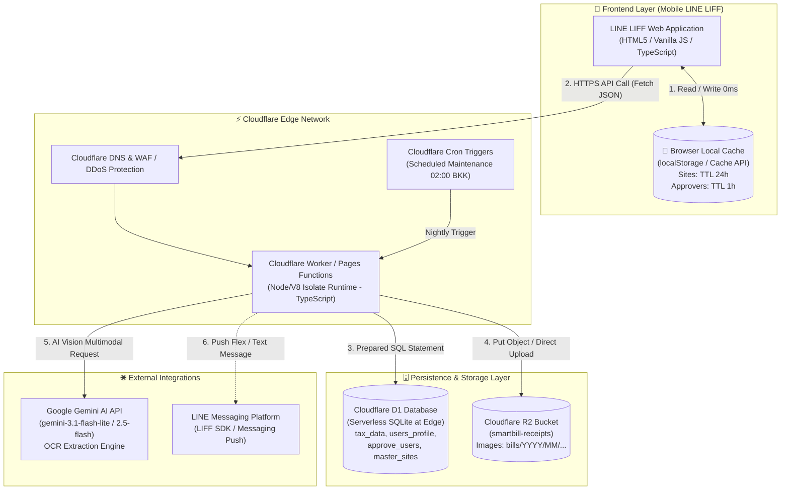
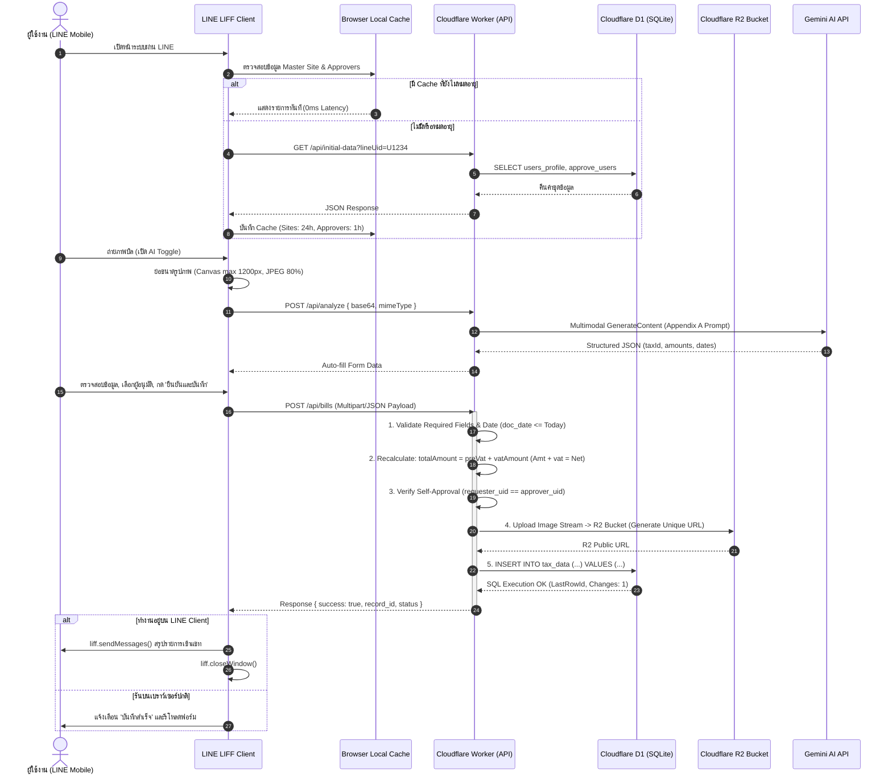

# Cloudflare Migration Specification: SmartBill Modernization
## Architecture, DBA Schema & Business Logic Specification (D1 + R2 + TypeScript)

**เอกสารข้อกำหนดการย้ายระบบ (Migration Specification Document)**  
**ระบบเดิม:** Google Apps Script (GAS) + Google Sheets + Google Drive  
**ระบบใหม่:** Cloudflare Workers (TypeScript) + Cloudflare D1 (SQLite) + Cloudflare R2 (Object Storage)  
**เวอร์ชันเอกสาร:** 3.0 (Enterprise Architecture Edition)  
**จัดทำโดย:** Principal System Analyst & Chief Database Administrator (DBA)  
**กลุ่มเป้าหมาย:** Cloudflare Development Team, Backend/Frontend Engineers, DevOps, QA  

---

## 📑 สารบัญ (Table of Contents)

1. [บทสรุปผู้บริหารและขอบเขตงาน (Executive Summary & Scope)](#1-บทสรุปผู้บริหารและขอบเขตงาน)
2. [สถาปัตยกรรมระบบใหม่บน Cloudflare (Target Architecture)](#2-สถาปัตยกรรมระบบใหม่บน-cloudflare)
3. [ตารางเปรียบเทียบและตัดทิ้งส่วนประกอบ GAS (Legacy vs Modern Topology)](#3-ตารางเปรียบเทียบและตัดทิ้งส่วนประกอบ-gas)
4. [ข้อกำหนด DBA & โครงสร้างฐานข้อมูล Cloudflare D1 (Database Specification)](#4-ข้อกำหนด-dba--โครงสร้างฐานข้อมูล-cloudflare-d1)
   - 4.1 ตาราง `tax_data` (ข้อมูลบิลหลัก)
   - 4.2 ตาราง `users_profile` (ข้อมูลโปรไฟล์และสิทธิ์ผู้ใช้งาน)
   - 4.3 ตาราง `approve_users` (ข้อมูลรายชื่อผู้อนุมัติ)
   - 4.4 ตาราง `master_sites` (ข้อมูลโครงการ/สาขา)
   - 4.5 ตาราง `tax_data_archive` (ตารางจัดเก็บประวัติหลัง Retention Period)
   - 4.6 กลยุทธ์การสร้าง Index เพื่อความเร็วสูงสุด (Indexing Strategy)
   - 4.7 Migration Scripts (DDL SQL) & Initial Seeds
5. [ข้อกำหนดระบบจัดเก็บรูปภาพ Cloudflare R2 (Object Storage Specification)](#5-ข้อกำหนดระบบจัดเก็บรูปภาพ-cloudflare-r2)
   - 5.1 การออกแบบ Bucket และ Path Hierarchy
   - 5.2 กลยุทธ์การอัปโหลด (Presigned URL vs Direct Stream API)
   - 5.3 การกระจายรูปภาพผ่าน Cloudflare CDN & การควบคุมความปลอดภัย
6. [ข้อกำหนดทางธุรกิจและ Business Logic (Preserved Business Rules)](#6-ข้อกำหนดทางธุรกิจและ-business-logic)
   - 6.1 Rule 1: Fixed Request Type (`req_type = "2"`)
   - 6.2 Rule 2: Approver Filtering (`pettycash_approve = 'NO'`)
   - 6.3 Rule 3: Self-Approval Auto-Payment (v2.7 Core Logic)
   - 6.4 Rule 4: Backend Total Amount Recalculation
   - 6.5 Rule 5: Bill Date Validation (`doc_date <= today`)
   - 6.6 Rule 6: Gemini OCR Strict Engine & Parsing Rules
   - 6.7 Rule 7: Project & Site List Resolution
   - 6.8 Rule 8: User Profile Isolation
   - 6.9 Rule 9: Combined Initial Data Dispatch (`getInitialData`)
   - 6.10 Rule 10: Bill Status Tracking & Analytics Engine (`getMyBills`)
   - 6.11 Rule 11: Data Retention & Automated Maintenance (`dailyMaintenance`)
   - 6.12 Rule 12: Database Backup Strategy (Replaces Legacy Email Attachment)
7. [สถาปัตยกรรม Local Cache ฝั่ง Client (Zero Server Cache, Max Efficiency)](#7-สถาปัตยกรรม-local-cache-ฝั่ง-client)
   - 7.1 เหตุผลทางสถาปัตยกรรมในการตัด Server-Side Cache
   - 7.2 โครงสร้าง Browser LocalStorage / IndexedDB Cache
   - 7.3 Cache-Control HTTP Headers & Stale-While-Revalidate
   - 7.4 กลไกการบังคับโหลดข้อมูลใหม่ (Manual Force Fresh)
8. [ข้อกำหนด RESTful API Contract (TypeScript Interfaces & Endpoints)](#8-ข้อกำหนด-restful-api-contract)
   - 8.1 Data Transfer Objects (DTO) และ Type Definitions
   - 8.2 Endpoints Specification
9. [โครงสร้างโค้ดและตัวอย่างการพัฒนา Cloudflare Worker (TypeScript Project Structure)](#9-โครงสร้างโค้ดและตัวอย่างการพัฒนา-cloudflare-worker)
10. [แผนการย้ายข้อมูลประวัติเดิม (Data Migration ETL Plan)](#10-แผนการย้ายข้อมูลประวัติเดิม)
11. [Checklist การพัฒนาและการทดสอบ (Acceptance Criteria & Test Matrix)](#11-checklist-การพัฒนาและการทดสอบ)

---

## 1. บทสรุปผู้บริหารและขอบเขตงาน

ระบบ **SmartBill** เป็นระบบรับและตรวจสอบบิล/ใบกำกับภาษีผ่าน LINE LIFF บนอุปกรณ์มือถือ พร้อมระบบวิเคราะห์รูปบิลอัตโนมัติด้วย AI (Gemini) และระบบติดตามสถานะการเบิกจ่าย

เดิมระบบทำงานอยู่บน **Google Apps Script (GAS) + Google Sheets + Google Drive** ซึ่งมีข้อจำกัดอย่างมากในด้าน:
1. ความเร็วและ Latency ของ Google Apps Script (เฉลี่ย 1.5 - 4.5 วินาทีต่อคำขอ)
2. ขีดจำกัดโควต้า (Google Quota Limits: Execution Time, URL Fetch, Drive API, Lock Contention บน Google Sheets)
3. ปัญหา Concurrency Lock เมื่อมีการบันทึกข้อมูลพร้อมกันหลายคน
4. โครงสร้าง Server-Side Cache ซับซ้อน (Central Cache API, Script Cache 600 วินาที) ที่ต้องคอยบำรุงรักษาหลายจุด

**เป้าหมายของการย้ายระบบ (Migration Objectives):**
- ย้าย Core Backend ทั้งหมดสู่ **Cloudflare Workers (TypeScript)** ทำงานที่ Edge รองรับความเร็วระดับ Sub-100ms
- ย้ายฐานข้อมูลจาก Google Sheets สู่ **Cloudflare D1 (Serverless Distributed SQLite)** มี ACID Transaction, Indexing และรองรับ Relational Constraints
- ย้ายพื้นที่จัดเก็บไฟล์รูปบิลจาก Google Drive สู่ **Cloudflare R2 Object Storage** (S3-compatible, Zero Egress Fee)
- **รักษา Business Logic, สถานะ, กฎการคำนวณภาษี, Self-Approval และ Flow การทำงานทั้งหมดไว้ 100%**
- **ตัดโค้ดเฉพาะทางของ GAS และ Google Sheets ออกทั้งหมด 100%**
- **ตัดเทคนิค Server-Side Cache (CacheService, Central App GAS) ออกทั้งหมด** โดยใช้ขุมพลังของ D1 โดยตรง
- **คงไว้และพัฒนาระบบ Local Cache ฝั่ง Client (Browser)** เพื่อให้ผู้ใช้งานเปิดหน้าจอได้ทันที 0ms และประหยัดโควต้าการ Query D1 ให้เหลือน้อยที่สุด

---

## 2. สถาปัตยกรรมระบบใหม่บน Cloudflare

### 2.1 ภาพรวมสถาปัตยกรรมใหม่ (Target Topology)



### 2.2 ลำดับการทำงานของการบันทึกบิล (Submit Flow Sequence Diagram)



---

## 3. ตารางเปรียบเทียบและตัดทิ้งส่วนประกอบ GAS

| องค์ประกอบเดิมใน GAS | เทคโนโลยีใหม่บน Cloudflare | สิ่งที่ต้องตัดออก 100% | สิ่งที่ต้องทำแทนในระบบใหม่ |
|---|---|---|---|
| `SpreadsheetApp.openById(...)` | Cloudflare D1 (`env.DB.prepare(...)`) | ตัดการเปิดไฟล์ Google Sheet, การหา Tab, การคำนวณ Row/Col | รัน SQL Query แบบ Prepared Statement รวดเร็ว ไม่ติด Sheet Lock |
| `SheetRepo.appendRow(...)` | SQL `INSERT INTO tax_data` | ตัดการแทรกแถว Array และ Prefix `'` หน้าข้อความ | ใช้ SQL Parameterized Query บันทึกประเภทข้อมูลตรงตาม Data Affinity |
| `PropertiesService.getScriptProperties()` | Cloudflare Worker Environment Variables (`env.*`) | ตัดการเรียก Properties API ของ Google | กำหนดตัวแปรใน `wrangler.toml` และ `wrangler secret` |
| `DriveApp.createFile(...)` | Cloudflare R2 Bucket (`env.R2_BUCKET.put(...)`) | ตัด Google Drive API, Folder ID, สิทธิ์ Sharing | เก็บ Object ลงใน R2 คืนค่า CDN URL ทันที ไม่มีปัญหาโควต้า Drive เต็ม |
| `CacheService.getScriptCache()` | **ตัดออกทั้งหมด (No Server Cache)** | ตัดโค้ด Server Cache ใน Apps Script ออกทั้งหมด | เรียก D1 ตรงๆ เพราะ D1 ทำงานระดับ Millisecond ที่ Edge อยู่แล้ว |
| `Central App URL & SHARED_TOKEN` | Direct Local D1 Query | ตัด Central Web App URL, Token, และ Direct Sheet Fallback | ตาราง `master_sites` อยู่ใน D1 โค้ดอ่านจาก D1 ได้ทันที |
| `LockService.getScriptLock()` | Cloudflare D1 Native ACID Transaction | ตัด `lock.waitLock()` และ `lock.releaseLock()` | D1 (SQLite) จัดการ Transaction ความพร้อมกันระดับฐานข้อมูลอัตโนมัติ |
| `UrlFetchApp.fetch(...)` | Native `fetch(...)` (Web Standard API) | ตัด UrlFetchApp wrapper | ใช้ standard `fetch()` ของ Worker runtime |
| `Session.getScriptTimeZone()` | UTC / Asia/Bangkok Native Date Handling | ตัดการแปลงเวลาผ่าน Google Session | บันทึก ISO-8601 UTC ในฐานข้อมูล และ Format Asia/Bangkok บน Worker/Client |
| `MailApp.sendEmail(...)` | Cloudflare Cron + R2 Snapshot / Webhook | ตัดการส่งอีเมลแนบไฟล์ `.xlsx` ผ่าน Gmail | ใช้ Cron Trigger สำรองฐานข้อมูล D1 เป็น Snapshot ลงใน R2 รายวัน |

---

## 4. ข้อกำหนด DBA & โครงสร้างฐานข้อมูล Cloudflare D1

Cloudflare D1 เป็นฐานข้อมูล Relational Database ที่ขับเคลื่อนด้วย **SQLite** ซึ่งทำงานแบบ Distributed Read-Replica ทั่วโลก และประมวลผล Write แบบรวมศูนย์ ทุกตารางต้องปฏิบัติตามมาตรฐาน SQLite Strict Type หรือ Type Affinity อย่างเคร่งครัด

### 4.1 ตาราง `tax_data` (ตารางหลักสำหรับเก็บข้อมูลบิล)
> **หมายเหตุ DBA:** ทดแทนแท็บ `TaxData` เดิม (คอลัมน์ A–V) โดยแปลงชื่อคอลัมน์ให้อยู่ในรูปแบบ `snake_case` ตามมาตรฐานฐานข้อมูลสากล

| คอลัมน์ D1 | SQLite Type | Constraints | ค่าเริ่มต้น (Default) | แมปปิ้งเดิม (Sheet Col) | คำอธิบายรายละเอียด |
|---|---|---|---|:---:|---|
| `record_id` | `TEXT` | `PRIMARY KEY` | - | **P** (`record_id`) | รหัสเอกสาร Unique ID (Timestamp string เช่น `'1725000000000'` หรือ UUIDv7) |
| `created_at` | `TEXT` | `NOT NULL` | `(datetime('now', '+7 hours'))` | **A** (`Update_datetime`) | วันเวลาที่บันทึกข้อมูล (ISO-8601 Asia/Bangkok) |
| `tax_id` | `TEXT` | `NOT NULL` | `''` | **B** (`Tax_id`) | เลขประจำตัวผู้เสียภาษี 13 หลักของผู้ขาย |
| `vend_name` | `TEXT` | `NOT NULL` | `''` | **C** (`Vend_name`) | ชื่อบริษัท หรือ ร้านค้าผู้ขาย |
| `branch_no` | `TEXT` | `NOT NULL` | `'00000'` | **D** (`Branch_no`) | รหัสสาขา 5 หลัก (ค่าเริ่มต้นคือ `'00000'`) |
| `tax_docno` | `TEXT` | `NULL` | `''` | **E** (`Tax_docno`) | เลขที่ใบกำกับภาษี / ใบเสร็จรับเงิน |
| `doc_date` | `TEXT` | `NOT NULL` | - | **F** (`doc_date`) | วันที่บนเอกสาร จัดเก็บในรูปแบบ ISO `YYYY-MM-DD` |
| `amt` | `REAL` | `NOT NULL` | `0.00` | **G** (`Amt`) | **ยอดก่อนภาษีมูลค่าเพิ่ม (Pre-VAT Amount)** |
| `vat` | `REAL` | `NOT NULL` | `0.00` | **H** (`vat`) | ยอดภาษีมูลค่าเพิ่ม (VAT Amount) ถ้าไม่มีภาษีให้เป็น 0.00 |
| `net` | `REAL` | `NOT NULL` | `0.00` | **I** (`Net`) | **ยอดรวมสุทธิ** คำนวณจาก `amt + vat` เสมอ |
| `project` | `TEXT` | `NULL` | `''` | **J** (`Project`) | รหัสหรือชื่อโครงการที่เบิกจ่าย (อ้างอิงจาก `master_sites`) |
| `remark` | `TEXT` | `NULL` | `''` | **K** (`Remark`) | สรุปรายการสินค้า/บริการ หรือหมายเหตุ |
| `pic_bill` | `TEXT` | `NULL` | `''` | **L** (`Pic_bill`) | URL ลิงก์รูปบิลที่จัดเก็บบน Cloudflare R2 Bucket |
| `users_name` | `TEXT` | `NOT NULL` | `'LIFF User'` | **M** (`users_name`) | LINE Email หรือระบุเป็น `'LIFF User'` |
| `request_name` | `TEXT` | `NOT NULL` | `''` | **N** (`Request_Name`) | ชื่อ-นามสกุลจริงของผู้ขอเบิก |
| `line_uid` | `TEXT` | `NOT NULL` | - | **O** (`Line_UID`) | LINE User ID ของผู้บันทึก (คีย์หลักในการค้นหา) |
| `approve_request`| `TEXT` | `NOT NULL` | `''` | **Q** (`approve_request`) | ชื่อผู้อนุมัติที่ผู้ใช้เลือกจาก Dropdown |
| `approve_userid` | `TEXT` | `NULL` | `NULL` | **R** (`approve_userid`) | LINE UID ของผู้อนุมัติ (มีค่าทันทีถ้า Self-Approval) |
| `approve_datetime`| `TEXT` | `NULL` | `NULL` | **S** (`approve_datetime`)| วันเวลาที่มีการอนุมัติ (ISO-8601) |
| `status` | `TEXT` | `NOT NULL` | `'pending'` | **T** (`status`) | สถานะ: `'pending'`, `'paided'`, `'approved'`, `'rejected'` |
| `req_type` | `TEXT` | `NOT NULL` | `'2'` | **U** (`req_type`) | ประเภทการเบิก: บังคับเป็น `'2'` ทุกกรณี (v2.6/v2.7 Spec) |
| `pettycash_batch_id`| `TEXT`| `NULL` | `NULL` | **V** (`pettycash_batch_id`)| สำหรับเชื่อมโยง Project 2 (เริ่มต้นเป็น `NULL`) |

---

### 4.2 ตาราง `users_profile` (ตารางโปรไฟล์และสิทธิ์ผู้ใช้งาน)
> **หมายเหตุ DBA:** ทดแทนแท็บ `users_profile` เดิม

| คอลัมน์ D1 | SQLite Type | Constraints | ค่าเริ่มต้น | แมปปิ้งเดิม | คำอธิบาย |
|---|---|---|---|:---:|---|
| `line_uid` | `TEXT` | `PRIMARY KEY` | - | `line_uid` | LINE User ID (Unique Key) |
| `request_name` | `TEXT` | `NOT NULL` | `''` | `Request_Name` | ชื่อ-นามสกุลจริง สำหรับ Auto-fill ในหน้าบันทึกบิล |
| `emp_no` | `TEXT` | `NULL` | `''` | `emp_no` | รหัสพนักงาน |
| `pc_limit` | `REAL` | `NOT NULL` | `0.00` | `pc.limit` | วงเงินสดย่อยที่ได้รับมอบหมาย |
| `is_active` | `INTEGER` | `NOT NULL` | `1` | - | สถานะผู้ใช้งาน (1 = ใช้งาน, 0 = ระงับ) |
| `updated_at` | `TEXT` | `NOT NULL` | `(datetime('now', '+7 hours'))` | - | วันเวลาที่อัปเดตข้อมูลล่าสุด |

---

### 4.3 ตาราง `approve_users` (ตารางรายชื่อผู้อนุมัติ)
> **หมายเหตุ DBA:** ทดแทนแท็บ `Approve_users` เดิม

| คอลัมน์ D1 | SQLite Type | Constraints | ค่าเริ่มต้น | แมปปิ้งเดิม | คำอธิบาย |
|---|---|---|---|:---:|---|
| `id` | `INTEGER` | `PRIMARY KEY AUTOINCREMENT` | - | - | Auto-increment Sequence ID |
| `approve_request` | `TEXT` | `NOT NULL UNIQUE` | - | `approve_request` | ชื่อผู้อนุมัติที่แสดงบน Dropdown หน้าบ้าน |
| `line_profile` | `TEXT` | `NULL` | `''` | `line_profile` | ชื่อ LINE Profile Display Name |
| `line_uid` | `TEXT` | `NOT NULL` | - | `line_uid` | LINE User ID ของผู้อนุมัติ (ใช้เทียบ Self-Approval) |
| `pettycash_approve`| `TEXT` | `NOT NULL` | `'NO'` | `pettycash_approve`| กรองเฉพาะ `'NO'` สำหรับ SmartBill (Dropdown) |
| `is_active` | `INTEGER` | `NOT NULL` | `1` | - | 1 = Active, 0 = Inactive |

---

### 4.4 ตาราง `master_sites` (ตารางข้อมูลโครงการ/สาขา)
> **หมายเหตุ DBA:** ทดแทนแท็บ `Master_Site` เดิมในระบบ Central Cache

| คอลัมน์ D1 | SQLite Type | Constraints | ค่าเริ่มต้น | คำอธิบาย |
|---|---|---|---|---|
| `id` | `INTEGER` | `PRIMARY KEY AUTOINCREMENT` | - | Auto-increment Sequence ID |
| `site_code` | `TEXT` | `NULL` | `''` | รหัสโครงการ/สาขา |
| `site_name` | `TEXT` | `NOT NULL UNIQUE` | - | ชื่อโครงการ/สาขา (แสดงใน Dropdown) |
| `is_active` | `INTEGER` | `NOT NULL` | `1` | 1 = เปิดใช้งาน (Active), 0 = ปิดการใช้งาน |
| `sort_order` | `INTEGER` | `NOT NULL` | `0` | ลำดับการแสดงผลใน Dropdown |

---

### 4.5 ตาราง `tax_data_archive` (ตารางจัดเก็บประวัติหลัง Retention Period)
> **หมายเหตุ DBA:** รองรับงาน Maintenance ประจำวัน (ย้ายบิลที่อนุมัติแล้วเกิน 14 วัน ออกจากตารางหลัก เพื่อให้ตาราง `tax_data` ทำงานเบาและเร็วตลอดเวลา)

- โครงสร้างคอลัมน์เหมือน `tax_data` ทุกประการ เพิ่มคอลัมน์ `archived_at TEXT NOT NULL DEFAULT (datetime('now', '+7 hours'))`

---

### 4.6 กลยุทธ์การสร้าง Index เพื่อความเร็วสูงสุด (Indexing Strategy)

เพื่อให้ API ตอบสนองได้ต่ำกว่า 20ms แม้มีข้อมูลนับแสนรายการ DBA ได้ออกแบบ Index ให้ครอบคลุมทุก Access Pattern ดังนี้:

```sql
-- 1. Index ค้นหาบิลของผู้ใช้งาน (Project 3 / getMyBills Query)
CREATE INDEX idx_tax_data_line_uid_created ON tax_data (line_uid, created_at DESC);

-- 2. Index สำหรับการกรองตามสถานะและผู้ใช้งาน (Filter Tabs)
CREATE INDEX idx_tax_data_user_status ON tax_data (line_uid, status);

-- 3. Index สำหรับค้นหาผู้อนุมัติ (Self-Approval Resolution & Listing)
CREATE INDEX idx_approve_users_active_filter ON approve_users (pettycash_approve, is_active);

-- 4. Index สำหรับ Master Site Dropdown
CREATE INDEX idx_master_sites_active ON master_sites (is_active, sort_order ASC);

-- 5. Index สำหรับ Maintenance Cron (ค้นหาบิลที่อนุมัตินานเกิน 14 วัน)
CREATE INDEX idx_tax_data_maintenance ON tax_data (status, approve_datetime);
```

---

### 4.7 Migration Scripts (DDL SQL)

ไฟล์: `migrations/0001_initial_schema.sql`

```sql
-- Migration 0001: Initial Database Schema for SmartBill D1
-- Created: 2026-09-24

PRAGMA foreign_keys = ON;

-- 1. Users Profile Table
CREATE TABLE IF NOT EXISTS users_profile (
    line_uid TEXT PRIMARY KEY,
    request_name TEXT NOT NULL DEFAULT '',
    emp_no TEXT DEFAULT '',
    pc_limit REAL NOT NULL DEFAULT 0.00,
    is_active INTEGER NOT NULL DEFAULT 1,
    updated_at TEXT NOT NULL DEFAULT (datetime('now', '+7 hours'))
);

-- 2. Approver Users Table
CREATE TABLE IF NOT EXISTS approve_users (
    id INTEGER PRIMARY KEY AUTOINCREMENT,
    approve_request TEXT NOT NULL UNIQUE,
    line_profile TEXT DEFAULT '',
    line_uid TEXT NOT NULL,
    pettycash_approve TEXT NOT NULL DEFAULT 'NO',
    is_active INTEGER NOT NULL DEFAULT 1
);

-- 3. Master Sites Table
CREATE TABLE IF NOT EXISTS master_sites (
    id INTEGER PRIMARY KEY AUTOINCREMENT,
    site_code TEXT DEFAULT '',
    site_name TEXT NOT NULL UNIQUE,
    is_active INTEGER NOT NULL DEFAULT 1,
    sort_order INTEGER NOT NULL DEFAULT 0
);

-- 4. Main Tax Data Table
CREATE TABLE IF NOT EXISTS tax_data (
    record_id TEXT PRIMARY KEY,
    created_at TEXT NOT NULL DEFAULT (datetime('now', '+7 hours')),
    tax_id TEXT NOT NULL DEFAULT '',
    vend_name TEXT NOT NULL DEFAULT '',
    branch_no TEXT NOT NULL DEFAULT '00000',
    tax_docno TEXT DEFAULT '',
    doc_date TEXT NOT NULL,
    amt REAL NOT NULL DEFAULT 0.00,
    vat REAL NOT NULL DEFAULT 0.00,
    net REAL NOT NULL DEFAULT 0.00,
    project TEXT DEFAULT '',
    remark TEXT DEFAULT '',
    pic_bill TEXT DEFAULT '',
    users_name TEXT NOT NULL DEFAULT 'LIFF User',
    request_name TEXT NOT NULL DEFAULT '',
    line_uid TEXT NOT NULL,
    approve_request TEXT NOT NULL DEFAULT '',
    approve_userid TEXT DEFAULT NULL,
    approve_datetime TEXT DEFAULT NULL,
    status TEXT NOT NULL DEFAULT 'pending',
    req_type TEXT NOT NULL DEFAULT '2',
    pettycash_batch_id TEXT DEFAULT NULL
);

-- 5. Archive Table for Retention Cleanup
CREATE TABLE IF NOT EXISTS tax_data_archive (
    record_id TEXT PRIMARY KEY,
    created_at TEXT NOT NULL,
    tax_id TEXT,
    vend_name TEXT,
    branch_no TEXT,
    tax_docno TEXT,
    doc_date TEXT,
    amt REAL,
    vat REAL,
    net REAL,
    project TEXT,
    remark TEXT,
    pic_bill TEXT,
    users_name TEXT,
    request_name TEXT,
    line_uid TEXT,
    approve_request TEXT,
    approve_userid TEXT,
    approve_datetime TEXT,
    status TEXT,
    req_type TEXT,
    pettycash_batch_id TEXT,
    archived_at TEXT NOT NULL DEFAULT (datetime('now', '+7 hours'))
);

-- Indexes
CREATE INDEX IF NOT EXISTS idx_tax_data_line_uid_created ON tax_data (line_uid, created_at DESC);
CREATE INDEX IF NOT EXISTS idx_tax_data_user_status ON tax_data (line_uid, status);
CREATE INDEX IF NOT EXISTS idx_approve_users_active_filter ON approve_users (pettycash_approve, is_active);
CREATE INDEX IF NOT EXISTS idx_master_sites_active ON master_sites (is_active, sort_order ASC);
CREATE INDEX IF NOT EXISTS idx_tax_data_maintenance ON tax_data (status, approve_datetime);
```

---

## 5. ข้อกำหนดระบบจัดเก็บรูปภาพ Cloudflare R2

### 5.1 การออกแบบ Bucket และ Path Hierarchy
- **Bucket Name:** `smartbill-receipts`
- **Naming Convention:**  
  `bills/{YYYY}/{MM}/{record_id}_{hash}.jpg`  
  *ตัวอย่าง:* `bills/2026/09/1727150000000_a8f9b2.jpg`
- **Content-Type:** `image/jpeg` หรือ `image/png`
- **Metadata Tagging:**
  - `x-amz-meta-line-uid`: LINE User ID ของผู้บันทึก
  - `x-amz-meta-record-id`: Record ID ของบิล

### 5.2 กลยุทธ์การอัปโหลด (Upload Strategy)
มี 2 ทางเลือกที่สถาปัตยกรรมนี้รองรับ:
1. **ทางเลือกที่ 1 (Direct Stream ผ่าน Worker - แนะนำสำหรับ Version 1):**  
   Client ส่งรูป base64 หรือ FormData เข้ามาที่ `POST /api/bills` พร้อมข้อมูลฟอร์ม Worker จะทำการ Decode เป็น Binary Stream แล้วเขียนลง R2 ทันทีด้วย `env.R2_BUCKET.put(key, buffer, { httpMetadata: { contentType } })` วิธีนี้เรียบง่ายและเป็น Single Transaction เหมือนระบบเดิม
2. **ทางเลือกที่ 2 (Presigned S3 URL):**  
   Client ขอ Presigned URL จาก Worker แล้วอัปโหลดตรงไปยัง R2 ประหยัด Worker Execution Time สำหรับไฟล์ขนาดใหญ่

### 5.3 การกระจายรูปภาพผ่าน Cloudflare CDN & ความปลอดภัย
- ผูก Custom Domain กับ R2 Bucket เช่น `https://receipts.smartbill-app.com/` หรือทำ Proxy ผ่าน Worker Endpoint `/api/images/{key}`
- เปิดใช้งาน Cloudflare CDN Cache สำหรับรูปภาพ: `Cache-Control: public, max-age=31536000, immutable` (รูปบิลไม่มีการแก้ไขย้อนหลัง โหลดครั้งเดียว Cache ตลอดไป)
- ป้องกัน Hotlinking ด้วยการตรวจสอบ Referer หรืออนุญาตเฉพาะโดเมนของแอปพลิเคชัน

---

## 6. ข้อกำหนดทางธุรกิจและ Business Logic

ทีมพัฒนา Cloudflare ต้องรักษา Business Rules ต่อไปนี้ให้ตรงกับระบบ SmartBill v2.6 / v2.7 ทุกประการ:

### 6.1 Rule 1: Fixed Request Type (`req_type = "2"`)
- ไม่ว่าผู้ใช้จะส่งค่าใดมา หรือไม่ได้ส่งค่ามา Backend Worker จะบังคับบันทึกค่าคอลัมน์ `req_type = "2"` (ประเภทที่ 2: เบิกใช้วงเงินสดย่อย) ทุกกรณี
- ยกเลิกการตรวจสอบค่า `pettycash_control` ใน `users_profile` ตามสเปก v2.6

### 6.2 Rule 2: Approver Filtering (`pettycash_approve = 'NO'`)
- Dropdown รายชื่อผู้อนุมัติจะแสดงเฉพาะรายการจากตาราง `approve_users` ที่มีเงื่อนไข:
  ```sql
  SELECT approve_request, line_profile, line_uid 
  FROM approve_users 
  WHERE UPPER(TRIM(pettycash_approve)) = 'NO' AND is_active = 1 
  ORDER BY approve_request ASC;
  ```
- ผู้อนุมัติที่มี `pettycash_approve = 'YES'` เป็นกลุ่มผู้มีสิทธิ์อนุมัติสดย่อยของ Project 2 ห้ามนำมาแสดงใน Project 1

### 6.3 Rule 3: Self-Approval Auto-Payment (v2.7 Core Logic)
นี่คือฟังก์ชันสำคัญใน SmartBill v2.7:
- ในขั้นตอนการบันทึกบิล Backend Worker จะนำ `requesterLineUid` (ผู้บันทึก) และ `approverLineUid` (ผู้อนุมัติที่เลือก) มาตรวจสอบ:
  ```typescript
  const isSelfApproval = Boolean(
    requesterLineUid && 
    approverLineUid && 
    requesterLineUid.trim() === approverLineUid.trim()
  );
  ```
- **กรณีเป็น Self-Approval (`isSelfApproval === true`):**
  - คอลัมน์ `status` = `'Paided'` (บันทึกเป็น 'Paided' ทันที แทนที่จะเป็น 'pending')
  - คอลัมน์ `approve_userid` = `requesterLineUid`
  - คอลัมน์ `approve_datetime` = `datetime('now', '+7 hours')` (วันเวลาปัจจุบัน)
- **กรณีปกติ (คนอื่นอนุมัติ):**
  - คอลัมน์ `status` = `'pending'`
  - คอลัมน์ `approve_userid` = `NULL`
  - คอลัมน์ `approve_datetime` = `NULL`

### 6.4 Rule 4: Backend Total Amount Recalculation
- **ห้ามเชื่อถือยอดรวม (`totalAmount`) ที่ส่งมาจาก Client โดยตรง**
- Backend Worker ต้องคำนวณใหม่เสมอ:
  $$\text{net} = \text{round}(\text{amt} + \text{vat}, 2)$$
- โดย `amt` คือยอดก่อนภาษี (`preVat`) และ `vat` คือภาษีมูลค่าเพิ่ม (`vatAmount`)

### 6.5 Rule 5: Bill Date Validation (`doc_date <= today`)
- วันที่บนบิล (`doc_date`) ต้องไม่เกินวันที่ปัจจุบัน (เวลาท้องถิ่นประเทศไทย UTC+7)
- รูปแบบที่จัดเก็บบนฐานข้อมูล D1: `YYYY-MM-DD`
- รูปแบบที่ส่งแสดงผลให้ Project 3 / UI: `DD/MM/YYYY`

### 6.6 Rule 6: Gemini OCR Strict Engine & Parsing Rules
การเรียกใช้ Google Gemini API (โมเดล `gemini-3.1-flash-lite` หรือ `gemini-2.5-flash`) ต้องปฏิบัติตามคำสั่งควบคุมระดับสูงสุด:
1. **การแปลง พ.ศ. เป็น ค.ศ.:** หากปีที่ตรวจพบเป็น พ.ศ. (เช่น 69 หรือ 2569 ขึ้นไป) ให้ลบออกด้วย 543 เพื่อเป็น ค.ศ. (เช่น 2026) เสมอ
2. **การแปลงชื่อเดือนไทย:**
   - ม.ค. $\rightarrow$ 01, ก.พ. $\rightarrow$ 02, มี.ค. $\rightarrow$ 03, เม.ย. $\rightarrow$ 04
   - พ.ค. $\rightarrow$ 05, มิ.ย. $\rightarrow$ 06, ก.ค. $\rightarrow$ 07, ส.ค. $\rightarrow$ 08
   - ก.ย. $\rightarrow$ 09, ต.ค. $\rightarrow$ 10, พ.ย. $\rightarrow$ 11, ธ.ค. $\rightarrow$ 12
3. **กฎเหล็กเรื่องภาษี (VAT):**
   - **ห้ามคำนวณ VAT 7% เพิ่มเองโดยพลการเด็ดขาด**
   - หากในบิลไม่มีบรรทัดที่ระบุภาษีมูลค่าเพิ่ม ให้กำหนด `vatAmount = 0.00`
   - ในกรณีไม่มี VAT: ยอดรวม `totalAmount` ต้องเท่ากับยอดก่อนภาษี `preVat`
4. **พารามิเตอร์การเรียก:** `temperature: 0.1`, `responseMimeType: "application/json"` พร้อมบังคับใช้ JSON Schema (ดูรายละเอียดในหัวข้อ API)

### 6.7 Rule 7: Project & Site List Resolution
- ข้อมูลรายชื่อโครงการที่ใช้งาน ดึงจากตาราง `master_sites`:
  ```sql
  SELECT site_name FROM master_sites WHERE is_active = 1 ORDER BY sort_order ASC, site_name ASC;
  ```
- ส่งคืนเฉพาะ Array of strings: `["Site A", "Site B", "สำนักงานใหญ่"]`

### 6.8 Rule 8: User Profile Isolation
- ค้นหาข้อมูลโปรไฟล์ตาม `line_uid`:
  ```sql
  SELECT line_uid, request_name, emp_no, pc_limit 
  FROM users_profile 
  WHERE line_uid = ? AND is_active = 1;
  ```
- หากพบข้อมูล ให้นำ `request_name` ไป Auto-fill ในช่องชื่อผู้เบิกอัตโนมัติ

### 6.9 Rule 9: Combined Initial Data Dispatch (`getInitialData`)
- เพื่อลด Round-Trip Time เมื่อผู้ใช้เปิดแอป ให้ดึงข้อมูลโปรไฟล์และรายชื่อผู้อนุมัติรวมกันในการเรียกครั้งเดียว (Single Batch/Parallel Query บน D1)

### 6.10 Rule 10: Bill Status Tracking & Analytics Engine (`getMyBills`)
- ทำหน้าที่สำหรับหน้าจอ `checkstatus.html` (Project 3):
- ค้นหาเฉพาะรายการที่ `line_uid = ?` เรียงลำดับจากล่าสุดไปเก่าสุด (`created_at DESC`)
- คำนวณสรุปสถิติ (KPI Summary Cards):
  - `totalBills`: จำนวนรายการทั้งหมด
  - `pendingCount`, `pendingNet`: จำนวนและยอดรวมของสถานะ 'pending'
  - `paidedCount`, `paidedNet`: จำนวนและยอดรวมของสถานะ 'paided' (หรือ 'paid')
  - `approvedCount`, `approvedNet`: จำนวนและยอดรวมของสถานะ 'approved'
  - `rejectedCount`: จำนวนรายการที่ 'rejected'
  - `totalNet`: ยอดรวมสุทธิทุกรายการ

### 6.11 Rule 11: Data Retention & Automated Maintenance (`dailyMaintenance`)
- เดิมใช้ Apps Script Time-driven Trigger รายวัน
- บน Cloudflare: ใช้ **Cron Triggers** รันทุกวันเวลา 02:00 น. (เวลาไทย):
  ```sql
  -- คัดลอกรายการที่ได้รับการอนุมัติแล้วเกิน 14 วัน ไปยังตาราง Archive
  INSERT INTO tax_data_archive 
  SELECT *, datetime('now', '+7 hours') AS archived_at 
  FROM tax_data 
  WHERE approve_datetime IS NOT NULL 
    AND approve_datetime != '' 
    AND julianday('now', '+7 hours') - julianday(approve_datetime) > 14;

  -- ลบรายการที่ถูก Archive แล้วออกจากตารางหลัก
  DELETE FROM tax_data 
  WHERE approve_datetime IS NOT NULL 
    AND approve_datetime != '' 
    AND julianday('now', '+7 hours') - julianday(approve_datetime) > 14;
  ```

### 6.12 Rule 12: Database Backup Strategy
- ทดแทนการส่งอีเมลไฟล์ `.xlsx` เดิม
- Cron Trigger รายวันจะทำการ Export snapshot ข้อมูล D1 และเก็บไฟล์สำรอง (JSON หรือ SQLite Dump) ไว้ใน Cloudflare R2 โฟลเดอร์ `backups/YYYY-MM-DD-smartbill.json.gz` เพื่อความปลอดภัยสูงสุดและประหยัดพื้นที่จัดเก็บ

---

## 7. สถาปัตยกรรม Local Cache ฝั่ง Client (Zero Server Cache, Max Efficiency)

### 7.1 เหตุผลทางสถาปัตยกรรมในการตัด Server-Side Cache
1. **D1 Latency ต่ำมากอยู่แล้ว:** Cloudflare D1 ทำงานผ่าน Edge Data Centers ทั่วโลก ความเร็วในการอ่านข้อมูล (Edge Read) อยู่ในระดับเพียง 5–15 มิลลิวินาที การสร้าง Server-Side Cache เพิ่มเติม (เช่น CacheService หรือ KV) จึงไม่มีความจำเป็นและเป็นการเพิ่มจุดผิดพลาด (Over-engineering)
2. **ขจัดปัญหา Cache Invalidation:** ไม่ต้องกังวลว่าแอดมินแก้ไขรายชื่อผู้อนุมัติหรือโครงการแล้วข้อมูลบนเซิร์ฟเวอร์จะไม่อัปเดต
3. **ลดต้นทุน Cloudflare:** D1 มีโควต้าการอ่านฟรีถึง 5,000,000 reads/วัน การตัด Server Cache ทำให้ระบบเรียบง่ายขึ้น 100%

### 7.2 โครงสร้าง Browser LocalStorage Cache
เพื่อประหยัดโควต้า D1 และเปิดแอปได้เร็วระดับ **0ms** โดยไม่ต้องรอ Network Round-Trip ให้คงการทำงานของ Client Cache ไว้ดังนี้:

| ชุดข้อมูล | Storage Key | อายุแคช (TTL) | วัตถุประสงค์ |
|---|---|:---:|---|
| รายชื่อโครงการ (`site`) | `mcache_site_v1` | **24 ชั่วโมง** | ข้อมูลโครงการแทบไม่มีการเปลี่ยนแปลงระหว่างวัน โหลดครั้งเดียวใช้ได้ทั้งวัน |
| รายชื่อผู้อนุมัติ (`approvers`) | `mcache_approvers_v1` | **1 ชั่วโมง** | อัปเดตบ่อยกว่าเล็กน้อย ป้องกันกรณีเปลี่ยนรายชื่อผู้มีอำนาจอนุมัติ |

**รูปแบบโครงสร้างข้อมูลใน `localStorage`:**
```json
{
  "data": ["Site พระราม 9", "Site สุขุมวิท", "สำนักงานใหญ่"],
  "savedAt": 1727150000000,
  "expiresAt": 1727236400000
}
```

### 7.3 Cache-Control HTTP Headers & Stale-While-Revalidate
เมื่อ Client ต้องดึงข้อมูลจาก API Worker ให้ Worker ส่ง HTTP Headers เพื่อให้เบราว์เซอร์จัดการแคชระดับเน็ตเวิร์กให้อัตโนมัติ:
```http
Cache-Control: public, max-age=300, stale-while-revalidate=86400
ETag: W/"sites-hash-v1"
```

### 7.4 กลไกการบังคับโหลดข้อมูลใหม่ (Manual Force Fresh)
- บนหน้าจอจะมีปุ่ม **"🔄 โหลดข้อมูลใหม่"** อยู่ข้าง Dropdown โครงการ
- เมื่อผู้ใช้กดปุ่ม:
  1. สั่งล้างแคชในเครื่อง: `localStorage.removeItem('mcache_site_v1')`
  2. ยิง Request ไปยัง Worker: `GET /api/sites?fresh=true`
  3. บันทึกผลลัพธ์ใหม่ลงใน `localStorage` ทันที

---

## 8. ข้อกำหนด RESTful API Contract

### 8.1 Data Transfer Objects (DTO) และ Type Definitions

```typescript
// types/api.ts

export type BillStatus = 'pending' | 'paided' | 'approved' | 'rejected';

export interface ApproverDTO {
  approve_request: string;
  line_profile: string;
  line_uid: string;
  pettycash_approve: string;
}

export interface UserProfileDTO {
  found: boolean;
  request_name?: string;
  emp_no?: string;
  pc_limit?: number;
  error?: string;
}

export interface InitialDataResponse {
  profile: UserProfileDTO;
  approvers: ApproverDTO[];
}

export interface SubmitBillRequest {
  taxId: string;
  sellerName: string;
  branchCode: string;
  billNumber: string;
  billDate: string; // YYYY-MM-DD
  preVat: number | string;
  vatAmount: number | string;
  projectCode: string;
  expenseNote: string;
  reqType?: string; // Default: '2'
  approve_request: string;
  approve_line_uid?: string;
  requesterName: string;
  lineUserId: string;
  lineEmail?: string;
  base64Image?: string;
  mimeType?: string;
}

export interface SubmitBillResponse {
  success: boolean;
  message: string;
  record_id?: string;
  status?: BillStatus;
  fileUrl?: string;
}

export interface BillItemDTO {
  record_id: string;
  created_at: string;
  tax_id: string;
  Vend_name: string;
  Tax_docno: string;
  doc_date: string; // Format DD/MM/YYYY
  Net: number;
  project: string;
  Remark: string;
  approve_request: string;
  status: BillStatus;
  pettycash_batch_id: string;
  pic_bill: string;
}

export interface BillSummaryDTO {
  totalBills: number;
  pendingCount: number;
  paidedCount: number;
  approvedCount: number;
  rejectedCount: number;
  totalNet: number;
  pendingNet: number;
  paidedNet: number;
  approvedNet: number;
}

export interface MyBillsResponse {
  summary: BillSummaryDTO;
  bills: BillItemDTO[];
}

export interface AnalyzeOcrRequest {
  base64: string;
  type: string;
}

export interface AnalyzeOcrResponse {
  taxId: string;
  sellerName: string;
  branchCode: string;
  billNumber: string;
  billDate: string; // YYYY-MM-DD
  preVat: number;
  vatAmount: number;
  totalAmount: number;
  expenseNote: string;
}
```

---

### 8.2 Endpoints Specification

#### 1. `POST /api/analyze` — วิเคราะห์บิลด้วย AI (Gemini OCR)
- **Method:** `POST`
- **Request Body:** `{ base64: string, type: string }`
- **Headers:** `Content-Type: application/json`
- **Response Success (200 OK):**
  ```json
  {
    "success": true,
    "data": {
      "taxId": "0105558000000",
      "sellerName": "บริษัท ตัวอย่าง จำกัด",
      "branchCode": "00000",
      "billNumber": "INV-2026-001",
      "billDate": "2026-09-24",
      "preVat": 1000.00,
      "vatAmount": 70.00,
      "totalAmount": 1070.00,
      "expenseNote": "ค่าวัสดุอุปกรณ์สำนักงาน"
    }
  }
  ```

#### 2. `GET /api/initial-data` — ดึงข้อมูลโปรไฟล์และรายชื่อผู้อนุมัติ
- **Method:** `GET`
- **Query Parameters:** `lineUid=U1234567890abcdef`
- **Response Success (200 OK):**
  ```json
  {
    "success": true,
    "data": {
      "profile": {
        "found": true,
        "request_name": "สมชาย ใจดี",
        "emp_no": "EMP001",
        "pc_limit": 10000.00
      },
      "approvers": [
        {
          "approve_request": "สมศักดิ์ ผู้จัดการ",
          "line_profile": "Somsak M.",
          "line_uid": "U9876543210fedcba",
          "pettycash_approve": "NO"
        }
      ]
    }
  }
  ```

#### 3. `GET /api/sites` — ดึงรายชื่อโครงการ
- **Method:** `GET`
- **Query Parameters:** `fresh=true` (Optional: ถ้าต้องการข้าม CDN Cache)
- **Response Headers:** `Cache-Control: public, max-age=300, stale-while-revalidate=86400`
- **Response Success (200 OK):**
  ```json
  {
    "success": true,
    "data": [
      "Site พระราม 9",
      "Site บางนา",
      "สำนักงานใหญ่"
    ]
  }
  ```

#### 4. `POST /api/bills` — บันทึกข้อมูลบิลใหม่
- **Method:** `POST`
- **Request Body:** JSON Payload ตาม `SubmitBillRequest`
- **Response Success (201 Created):**
  ```json
  {
    "success": true,
    "data": "บันทึกสำเร็จ",
    "record_id": "1727156789123",
    "status": "Paided",
    "fileUrl": "https://receipts.domain.com/bills/2026/09/1727156789123.jpg"
  }
  ```

#### 5. `GET /api/bills/my` — ดึงข้อมูลบิลและสรุปสถิติของผู้ใช้งาน
- **Method:** `GET`
- **Query Parameters:** `lineUid=U1234567890abcdef`
- **Response Success (200 OK):**
  ```json
  {
    "success": true,
    "data": {
      "summary": {
        "totalBills": 12,
        "pendingCount": 2,
        "paidedCount": 8,
        "approvedCount": 2,
        "rejectedCount": 0,
        "totalNet": 15420.50,
        "pendingNet": 2300.00,
        "paidedNet": 11120.50,
        "approvedNet": 2000.00
      },
      "bills": [
        {
          "record_id": "1727156789123",
          "created_at": "2026-09-24 13:45:00",
          "tax_id": "0105558000000",
          "Vend_name": "โฮมโปร",
          "Tax_docno": "INV-9988",
          "doc_date": "24/09/2026",
          "Net": 1500.00,
          "project": "Site พระราม 9",
          "Remark": "ซื้อหลอดไฟและเทปพันสายไฟ",
          "approve_request": "สมชาย ใจดี",
          "status": "paided",
          "pettycash_batch_id": "",
          "pic_bill": "https://receipts.domain.com/bills/2026/09/1727156789123.jpg"
        }
      ]
    }
  }
  ```

---

## 9. โครงสร้างโค้ดและตัวอย่างการพัฒนา Cloudflare Worker

### 9.1 โครงสร้างโฟลเดอร์โปรเจกต์ (Project Directory Layout)

```
smartbill-cloudflare/
├── .github/workflows/deploy.yml
├── migrations/
│   └── 0001_initial_schema.sql
├── src/
│   ├── index.ts                # Router หลัก (ใช้ Hono หรือ Standard Request Fetch)
│   ├── config.ts               # Configuration & Environment Binding Type
│   ├── db/
│   │   ├── client.ts           # D1 Database Helper & Query Wrappers
│   │   └── schema.ts           # D1 Schema Type Definitions
│   ├── services/
│   │   ├── bill.service.ts     # Submit Bill, Calculate Total, Self-Approval Logic
│   │   ├── status.service.ts   # getMyBills & Summary Engine
│   │   ├── ocr.service.ts      # Gemini AI Vision Multimodal Integration
│   │   ├── storage.service.ts  # R2 Upload & URL Generation
│   │   ├── master.service.ts   # Sites & Approvers Queries
│   │   └── cron.service.ts     # Daily Retention Maintenance & Backups
│   ├── types/
│   │   └── api.ts              # Data Transfer Objects (DTO)
│   └── utils/
│       ├── date.ts             # Timezone & Thai Date Helpers
│       └── response.ts         # Standard JSON Response Helpers
├── package.json
├── tsconfig.json
└── wrangler.toml               # D1, R2, Cron, Environment Bindings
```

---

### 9.2 ตัวอย่างการกำหนดค่า `wrangler.toml`

```toml
name = "smartbill-api"
main = "src/index.ts"
compatibility_date = "2026-09-24"
compatibility_flags = ["nodejs_compat"]

# Cloudflare D1 Database Binding
[[d1_databases]]
binding = "DB"
database_name = "smartbill-db"
database_id = "<YOUR_D1_DATABASE_ID>"

# Cloudflare R2 Bucket Binding
[[r2_buckets]]
binding = "RECEIPTS_BUCKET"
bucket_name = "smartbill-receipts"

# Cron Triggers (Run Daily at 02:00 AM Bangkok Time / 19:00 UTC)
[triggers]
crons = ["0 19 * * *"]

# Global Variables
[vars]
GEMINI_MODEL = "gemini-3.1-flash-lite"
DAYS_TO_KEEP = "14"
PUBLIC_R2_DOMAIN = "https://receipts.smartbill-app.com"

# Secrets (Set via: npx wrangler secret put <NAME>)
# - GEMINI_API_KEY
# - LIFF_CHANNEL_SECRET (Optional for ID Token verification)
```

---

### 9.3 ตัวอย่างการเขียน Service สำคัญบน Worker (TypeScript)

#### ตัวอย่าง: `src/services/bill.service.ts`
```typescript
import { SubmitBillRequest, SubmitBillResponse } from '../types/api';
import { uploadReceiptToR2 } from './storage.service';

export async function submitBill(
  env: Env,
  payload: SubmitBillRequest
): Promise<SubmitBillResponse> {
  // 1. Backend Numerical Validation & Recalculation (ห้ามเชื่อ Client)
  const preVat = Number(payload.preVat) || 0.0;
  const vatAmount = Number(payload.vatAmount) || 0.0;
  const totalAmount = Math.round((preVat + vatAmount) * 100) / 100;

  // 2. Validate Document Date (ห้ามเกินวันนี้)
  const todayStr = new Date().toLocaleDateString('en-CA', { timeZone: 'Asia/Bangkok' });
  if (payload.billDate > todayStr) {
    throw new Error('วันที่บนบิลต้องไม่เกินวันที่ปัจจุบันครับ');
  }

  // 3. Generate Record ID
  const recordId = Date.now().toString();

  // 4. Upload Receipt Image to R2 (ถ้ามี)
  let fileUrl = '';
  if (payload.base64Image && payload.mimeType) {
    fileUrl = await uploadReceiptToR2(
      env.RECEIPTS_BUCKET,
      env.PUBLIC_R2_DOMAIN,
      recordId,
      payload.base64Image,
      payload.mimeType
    );
  }

  // 5. Self-Approval Resolution (v2.7 Business Logic)
  const requesterUid = (payload.lineUserId || '').trim();
  let approverUid = (payload.approve_line_uid || '').trim();

  // Fallback: ถ้า Client ไม่ได้ส่ง Line UID ผู้อนุมัติมา ให้ Query จาก D1
  if (!approverUid && payload.approve_request) {
    const approverRow = await env.DB.prepare(
      'SELECT line_uid FROM approve_users WHERE approve_request = ? AND is_active = 1'
    ).bind(payload.approve_request).first<{ line_uid: string }>();
    if (approverRow?.line_uid) {
      approverUid = approverRow.line_uid.trim();
    }
  }

  const isSelfApproval = Boolean(
    requesterUid && approverUid && requesterUid === approverUid
  );

  const status = isSelfApproval ? 'Paided' : 'pending';
  const approveUserId = isSelfApproval ? requesterUid : null;
  const approveDateTime = isSelfApproval ? new Date().toISOString() : null;

  // 6. SQL Insert into D1 (ACID Transaction)
  await env.DB.prepare(`
    INSERT INTO tax_data (
      record_id, created_at, tax_id, vend_name, branch_no, tax_docno,
      doc_date, amt, vat, net, project, remark, pic_bill, users_name,
      request_name, line_uid, approve_request, approve_userid,
      approve_datetime, status, req_type, pettycash_batch_id
    ) VALUES (
      ?, datetime('now', '+7 hours'), ?, ?, ?, ?,
      ?, ?, ?, ?, ?, ?, ?, ?,
      ?, ?, ?, ?,
      ?, ?, '2', NULL
    )
  `).bind(
    recordId,
    payload.taxId || '',
    payload.sellerName || '',
    payload.branchCode || '00000',
    payload.billNumber || '',
    payload.billDate,
    preVat,
    vatAmount,
    totalAmount,
    payload.projectCode || '',
    payload.expenseNote || '',
    fileUrl,
    payload.lineEmail || 'LIFF User',
    payload.requesterName || '',
    requesterUid,
    payload.approve_request || '',
    approveUserId,
    approveDateTime,
    status
  ).run();

  return {
    success: true,
    message: 'บันทึกสำเร็จ',
    record_id: recordId,
    status: status as any,
    fileUrl: fileUrl
  };
}
```

---

#### ตัวอย่าง: `src/services/ocr.service.ts`
```typescript
import { AnalyzeOcrResponse } from '../types/api';

export async function analyzeInvoice(
  env: Env,
  base64Image: string,
  mimeType: string
): Promise<AnalyzeOcrResponse> {
  const apiKey = env.GEMINI_API_KEY;
  if (!apiKey) throw new Error('GEMINI_API_KEY is not configured');

  const model = env.GEMINI_MODEL || 'gemini-3.1-flash-lite';
  const url = `https://generativelanguage.googleapis.com/v1beta/models/${model}:generateContent?key=${apiKey}`;

  // กฎเหล็กและคำสั่งควบคุม OCR ตามสเปก Appendix A ห้ามแก้ไข Logic
  const prompt = `คุณคือผู้เชี่ยวชาญด้านบัญชีไทยที่มีความแม่นยำระดับสูงสุดในการอ่านลายมือเขียนและเอกสารบิลใบเสร็จ ใบกำกับภาษีของไทย
กฎเหล็กและคำสั่งควบคุม (OCR Strict Logic):
1. การสกัดวันที่ (Date Extraction):
   - อ่านวันที่จากภาพตามที่ปรากฏ (เช่น "25/ม.ค./69")
   - หากพบชื่อเดือนภาษาไทย ให้แปลงเป็นตัวเลขเดือนตามเงื่อนไขนี้เสมอ:
     (ม.ค.=01, ก.พ.=02, มี.ค.=03, เม.ย.=04, พ.ค.=05, มิ.ย.=06, ก.ค.=07, ส.ค.=08, ก.ย.=09, ต.ค.=10, พ.ย.=11, ธ.ค.=12)
   - หากปีที่ปรากฏเป็น พ.ศ. (เช่น 69 หรือ 2569 หรือมากกว่าเลขนี้) ให้ลบด้วย 543 เพื่อแปลงเป็น ค.ศ. (เช่น 2026) หากเป็น ค.ศ. อยู่แล้ว ห้ามลบซ้ำ
   - ส่งกลับในรูปแบบ YYYY-MM-DD เท่านั้น
   - If confidence < 90%, default today or this month only.
2. กฎเรื่องภาษี (VAT & Calculations) สำคัญมาก:
   - ห้ามคำนวณ VAT เพิ่มเองเด็ดขาด (Don't calculate VAT yourself)
   - หากในบิลไม่มีบรรทัดที่ระบุภาษีมูลค่าเพิ่มหรือ VAT ให้ใส่ vatAmount = 0.00 ทันที
   - ในกรณีไม่มี VAT: ยอดรวม (totalAmount) ต้องเท่ากับยอดก่อน VAT (preVat)
   - หากเป็น "บิลเงินสด" ที่เขียนมือ มักจะไม่มี VAT ให้ตรวจสอบยอดรวมที่ระบุไว้เป็นหลัก
3. การจัดการความผิดพลาด:
   - หากลายมืออ่านยากหรือไม่ชัดเจน ให้พยายามเทียบเคียงจากบริบทของบิลใบอื่นในชุดข้อมูล หรือส่งค่าที่ใกล้เคียงที่สุดโดยไม่เดาสุ่ม
5. ตอบกลับเป็น JSON บริสุทธิ์เท่านั้น ห้ามมี Markdown หรือคำบรรยาย
6. ข้อมูลที่สกัดได้ต้องตรงตามโครงสร้างที่กำหนด`;

  const payload = {
    contents: [
      {
        parts: [
          { text: prompt },
          { text: 'สกัดข้อมูลบิลนี้เป็น JSON' },
          { inline_data: { mime_type: mimeType, data: base64Image } }
        ]
      }
    ],
    generationConfig: {
      temperature: 0.1,
      responseMimeType: 'application/json',
      responseSchema: {
        type: 'object',
        properties: {
          taxId: { type: 'string' },
          sellerName: { type: 'string' },
          branchCode: { type: 'string' },
          billNumber: { type: 'string' },
          billDate: { type: 'string' },
          preVat: { type: 'number' },
          vatAmount: { type: 'number' },
          totalAmount: { type: 'number' },
          expenseNote: { type: 'string' }
        },
        required: [
          'taxId', 'sellerName', 'branchCode', 'billNumber',
          'billDate', 'preVat', 'vatAmount', 'totalAmount'
        ]
      }
    }
  };

  const response = await fetch(url, {
    method: 'POST',
    headers: { 'Content-Type': 'application/json' },
    body: JSON.stringify(payload)
  });

  if (!response.ok) {
    const errorText = await response.text();
    throw new Error(`Gemini API Error: ${response.status} - ${errorText}`);
  }

  const jsonResult: any = await response.json();
  const textContent = jsonResult.candidates?.[0]?.content?.parts?.[0]?.text;
  if (!textContent) throw new Error('Gemini API returned empty response');

  return JSON.parse(textContent);
}
```

---

#### ตัวอย่าง: `src/services/status.service.ts`
```typescript
import { MyBillsResponse, BillItemDTO, BillStatus } from '../types/api';

export async function getMyBills(env: Env, lineUid: string): Promise<MyBillsResponse> {
  if (!lineUid) throw new Error('Missing lineUid');

  // Query D1 ด้วย Index (line_uid, created_at DESC)
  const rows = await env.DB.prepare(`
    SELECT 
      record_id, created_at, tax_id, vend_name, branch_no,
      tax_docno, doc_date, amt, vat, net, project, remark,
      pic_bill, approve_request, status, pettycash_batch_id
    FROM tax_data
    WHERE line_uid = ?
    ORDER BY created_at DESC
  `).bind(lineUid.trim()).all<any>();

  const rawBills = rows.results || [];

  let pendingCount = 0;
  let paidedCount = 0;
  let approvedCount = 0;
  let rejectedCount = 0;
  let totalNet = 0;
  let pendingNet = 0;
  let paidedNet = 0;
  let approvedNet = 0;

  const bills: BillItemDTO[] = rawBills.map(row => {
    const netVal = Number(row.net) || 0.0;
    const statusVal = (row.status || 'pending').toLowerCase();

    let mappedStatus: BillStatus = 'pending';
    if (statusVal === 'paided' || statusVal === 'paid') {
      mappedStatus = 'paided';
      paidedCount++;
      paidedNet += netVal;
    } else if (statusVal === 'approved') {
      mappedStatus = 'approved';
      approvedCount++;
      approvedNet += netVal;
    } else if (statusVal === 'rejected') {
      mappedStatus = 'rejected';
      rejectedCount++;
    } else {
      mappedStatus = 'pending';
      pendingCount++;
      pendingNet += netVal;
    }

    totalNet += netVal;

    // Format doc_date to DD/MM/YYYY for UI Display
    let docDateFormatted = row.doc_date || '';
    if (docDateFormatted.includes('-')) {
      const parts = docDateFormatted.split('-');
      if (parts.length === 3) {
        docDateFormatted = `${parts[2]}/${parts[1]}/${parts[0]}`;
      }
    }

    return {
      record_id: String(row.record_id || ''),
      created_at: String(row.created_at || ''),
      tax_id: String(row.tax_id || ''),
      Vend_name: String(row.vend_name || ''),
      Tax_docno: String(row.tax_docno || ''),
      doc_date: docDateFormatted,
      Net: netVal,
      project: String(row.project || ''),
      Remark: String(row.remark || ''),
      approve_request: String(row.approve_request || ''),
      status: mappedStatus,
      pettycash_batch_id: String(row.pettycash_batch_id || ''),
      pic_bill: String(row.pic_bill || '')
    };
  });

  return {
    summary: {
      totalBills: bills.length,
      pendingCount,
      paidedCount,
      approvedCount,
      rejectedCount,
      totalNet: Math.round(totalNet * 100) / 100,
      pendingNet: Math.round(pendingNet * 100) / 100,
      paidedNet: Math.round(paidedNet * 100) / 100,
      approvedNet: Math.round(approvedNet * 100) / 100
    },
    bills
  };
}
```

---

## 10. แผนการย้ายข้อมูลประวัติเดิม (Data Migration ETL Plan)

ในการขึ้นระบบใหม่ ข้อมูลเก่าจาก Google Sheets ต้องถูก Migrate เข้า D1 อย่างปลอดภัยและไม่สูญหาย:

1. **Step 1: Export ข้อมูลจาก Google Sheets:**
   - Export แท็บ `TaxData`, `users_profile`, `Approve_users`, `Master_Site` ออกมาเป็นไฟล์ CSV หรือ JSON
2. **Step 2: สคริปต์ Cleanse & Transform:**
   - ตัดเครื่องหมาย `'` (single quote prefix) ออกจากตัวเลข Tax ID, Branch No, Document No
   - แปลงวันที่ `doc_date` ให้อยู่ในมาตรฐาน `YYYY-MM-DD` สากล
   - กำหนดค่า `amt`, `vat`, `net` เป็นตัวเลข Float/Real
   - แมปสถานะให้ตรงตาม Enum (`pending`, `paided`, `approved`, `rejected`)
3. **Step 3: นำเข้าสู่ Cloudflare D1:**
   - รันคำสั่งผ่าน Wrangler CLI:
     ```bash
     npx wrangler d1 execute smartbill-db --file=./migrations/0001_initial_schema.sql
     npx wrangler d1 execute smartbill-db --file=./migrations/seed_master_data.sql
     npx wrangler d1 execute smartbill-db --file=./migrations/migrated_tax_data.sql
     ```
4. **Step 4: Verify Data Integrity:**
   - เปรียบเทียบ Record Count และ Sum(Net) ระหว่าง Google Sheet เดิม กับ Cloudflare D1 ให้ผลลัพธ์ตรงกัน 100.00%

---

## 11. Checklist การพัฒนาและการทดสอบ

| ลำดับ | รายการทดสอบ (Test Scenario) | ผลลัพธ์ที่คาดหวัง (Expected Outcome) | ผ่าน/ไม่ผ่าน |
|:---:|---|---|:---:|
| 1 | **Initial Data Loading:** ผู้ใช้เปิด LIFF เข้าหน้าบันทึกบิล | ดึง Profile และ Approvers ได้ภายใน < 150ms พร้อมเติมชื่อผู้เบิกอัตโนมัติ | 🔲 |
| 2 | **Local Cache 24 ชม.:** ปิดแอปแล้วเปิดใหม่ภายใน 24 ชม. | รายชื่อโครงการใน Dropdown แสดงผลทันที 0ms โดยไม่เกิด Network Request | 🔲 |
| 3 | **ปุ่ม Refresh โครงการ:** กดปุ่ม 🔄 โหลดข้อมูลใหม่ | ล้าง Cache ในเครื่อง และดึงรายการล่าสุดจาก API พร้อมอัปเดตลง Dropdown | 🔲 |
| 4 | **AI OCR Analysis:** ถ่ายรูปบิลใบเสร็จที่มี VAT และไม่มี VAT | สกัดข้อมูลครบถ้วน แปลง พ.ศ. $\rightarrow$ ค.ศ. ถูกต้อง และไม่บวก VAT เอง | 🔲 |
| 5 | **Validation วันที่บิล:** เลือกวันที่บิลล่วงหน้าเกินวันปัจจุบัน | ระบบแจ้งเตือนปฏิเสธ และไม่อนุญาตให้กดบันทึก | 🔲 |
| 6 | **Self-Approval Test:** ผู้เบิกเลือกชื่อผู้อนุมัติเป็น **ตัวเอง** | Backend บันทึกสถานะเป็น `"Paided"`, ใส่ `approve_userid` และ `approve_datetime` ทันที | 🔲 |
| 7 | **Normal Approval Test:** ผู้เบิกเลือกชื่อผู้อนุมัติเป็น **บุคคลอื่น** | Backend บันทึกสถานะเป็น `"pending"`, ฟิลด์ `approve_userid` เป็น NULL | 🔲 |
| 8 | **Backend Amount Recalculate:** ลอง Mock ยอดรวมจาก Client ผิดไป | Backend คำนวณ `amt + vat = net` ใหม่เสมอ และบันทึกค่าที่ถูกต้องลง D1 | 🔲 |
| 9 | **R2 Image Storage:** ตรวจสอบรูปบิลหลังการบันทึก | รูปถูกจัดเก็บลง R2 Bucket โฟลเดอร์ `bills/YYYY/MM/` และเปิดดูผ่าน URL ได้ | 🔲 |
| 10 | **Status Tracking:** เปิดหน้า `checkstatus.html` | แสดงรายการบิลของผู้ใช้ถูกต้อง เรียงล่าสุดก่อน และสรุปการ์ดยอดเงินตรง 100% | 🔲 |
| 11 | **Cron Retention:** ทดสอบรันคำสั่ง Maintenance | บิลที่อนุมัติเกิน 14 วัน ถูกย้ายไป `tax_data_archive` และถูกลบออกจาก `tax_data` | 🔲 |

---

> **สรุปสำหรับทีมพัฒนา Cloudflare:**  
> ระบบใหม่นี้ไม่ขึ้นตรงกับ Google Apps Script หรือ Google Sheets อีกต่อไป สามารถพัฒนาเป็น Standalone Edge Application ได้ทันทีโดยใช้สเปกและโค้ดตัวอย่างในเอกสารนี้เป็นเกณฑ์ หากปฏิบัติตามข้อกำหนดทุกหัวข้อ ระบบจะทำงานได้รวดเร็ว ประหยัดโควต้า D1 และคงความถูกต้องของบัญชี 100%
